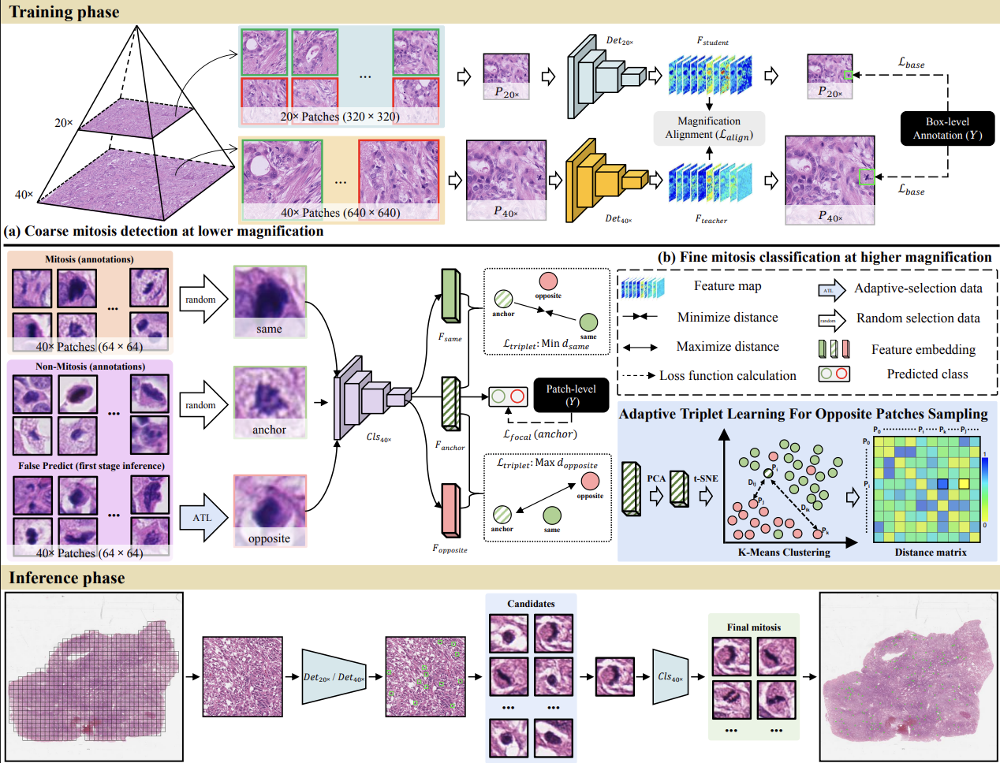

# RapidMitDet: Boosting Computational Efficiency for Mitosis Detection via Magnification Alignment

<strong>A Coarse-to-Fine Framework for Efficient Mitosis Detection in Histopathology Images</strong>


## 🔬 Overview

**RapidMitDet** is an efficient coarse-to-fine framework for mitosis detection in histopathology images, designed to reduce the computational burden of high-resolution inference while maintaining reliable detection performance.

The core idea is **Magnification Alignment (MAG)**, which enables a lightweight student detector operating at **20× magnification** to effectively leverage the knowledge learned by a teacher detector at **40× magnification**. By aligning representations across magnification levels, RapidMitDet substantially reduces the amount of high-resolution image processing required for mitosis detection.

The overall pipeline consists of:

**40× Teacher Detection → Magnification Alignment → 20× Student Detection → 40× Classification Refinement**



This repository provides the complete implementation for training, inference, and evaluation of RapidMitDet.

---

## 📊 Datasets

RapidMitDet supports the following public datasets:

### 1. MIDOG2021

A benchmark dataset for mitosis detection across multiple tumor types and institutions.

[**MIDOG2021 Dataset**](https://midog.deepmicroscopy.org/the-dataset/)

### 2. MIDOG2022

An extended multi-domain benchmark for evaluating mitosis detection under substantial domain variation.

[**MIDOG2022 Dataset**](https://midog.deepmicroscopy.org/download-dataset/)

### 3. MIDOG++

A large-scale extension of the MIDOG benchmark designed for more comprehensive evaluation of mitosis detection models.

[**MIDOG++ Dataset**](https://github.com/DeepMicroscopy/MIDOGpp)

### 4. TUPAC-auxiliary

Auxiliary data from the TUPAC challenge used for mitosis-related experiments.

[**TUPAC Dataset**](https://tupac.grand-challenge.org/Dataset/)

Please download the corresponding datasets from their official sources before running the training or evaluation pipeline.

---

## 🏗️ Project Structure

The repository is organized according to the complete RapidMitDet training and evaluation pipeline:

```text
.
├── 1_stain_augment.py          # Optional stain augmentation
├── 2_convert_to_detect.py      # Convert raw data to YOLO detection format
├── 3_train_detect.py           # Train the 40× teacher detector
├── 4_train_detect_align.py     # Train the 20× student detector with MAG
├── 5_convert_to_classify.py    # Convert raw data to 40× classification format
├── 6_detect_gen_patches.py     # Optional hard-sample generation
├── 7_train_classify.py         # Train the 40× classification model
├── 8_eval.py                   # Evaluation
├── 9_infer.py                  # Inference
├── ckpts/                      # Model checkpoints
├── dataset/                    # Dataset-related files
├── hyps/                       # Hyperparameter configurations
├── models/                     # Model implementations
└── utils/                      # Utility functions

```

## 📦 Pretrained Checkpoints

Pretrained checkpoints are provided to facilitate model evaluation and reproducibility.

You can download the checkpoints from either of the following sources:

- **[Google Drive](https://drive.google.com/drive/folders/1RfOJK4jwRLVxvRkReIx0xBZ-aTABIIEa?usp=sharing)**
- **[Baidu Netdisk](https://pan.baidu.com/s/1gqqQuQ1CXKESFOPMpld19g?pwd=qt7g)**

After downloading, place the checkpoint files into the `ckpts` directory:

```text
ckpts/
├── ...
└── ...
```

Once the checkpoints are correctly placed, the pretrained models can be directly evaluated using:
```shell
python 8_eval.py
```

## 🙏 Acknowledgments

Several components of this repository are directly adapted from or inspired by the following excellent open-source projects. We sincerely thank the authors and contributors for making their work publicly available:

- **[TorchVahadane](https://github.com/cwlkr/torchvahadane)**  
  Stain normalization and augmentation.

- **[Hyper-YOLO](https://github.com/iMoonLab/Hyper-YOLO)**  
  Object detection implementation and related components.

- **[HoVer-Net](https://github.com/vqdang/hover_net)**  
  Computational pathology and nuclei analysis framework.

We gratefully acknowledge their contributions to the open-source computational pathology community.